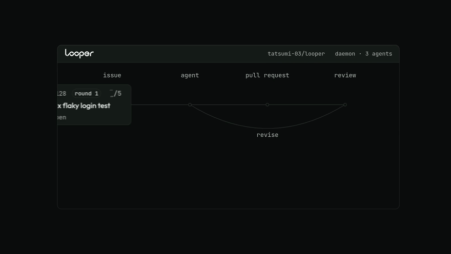
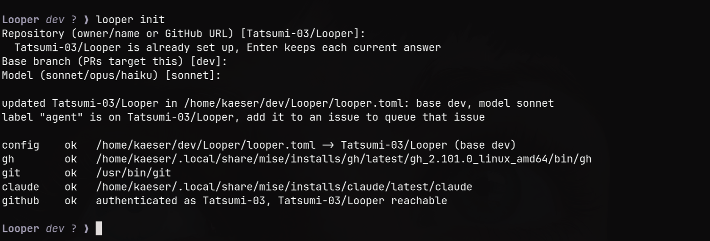
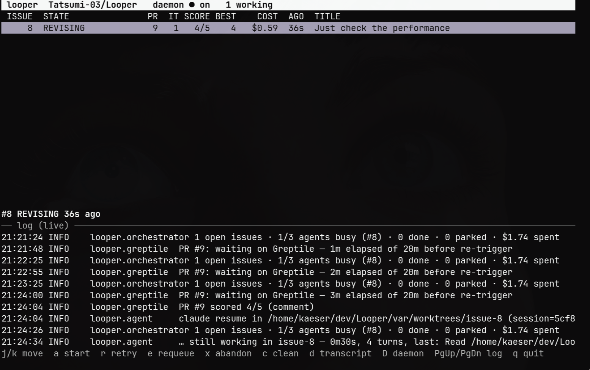

<p align="center">
  <picture>
    <source media="(prefers-color-scheme: dark)" srcset="assets/wordmark-dark.png">
    
  </picture>
</p>

<p align="center">
  <b>Turns open GitHub issues into merge-ready pull requests.</b><br>
  Runs on the Claude Code or Codex plan you already pay for: no API keys.
</p>

<p align="center">
  
</p>

For each open issue Looper starts a coding agent in its own git worktree, opens a PR, has it
reviewed, and hands the findings back to the agent, round after round, until the review scores
**5/5** and CI is green. Then it labels the PR `agent:ready` and stops. You merge.

```
issue ──► claim ──► worktree ──► agent solves ──► push ──► PR
                                                            │
                          ┌─────────────────────────────────┘
                          ▼
                    review scores N/5   ──► 5/5 + CI green? ──► agent:ready (you merge)
                          ▲                   │
                          └── agent revises ◄─┘   (up to max_iterations)
```

Several issues run at once, one worktree and branch each. Watch them from a terminal dashboard
or run headless.

## Requirements

- Python 3.11+. Looper has no third-party dependencies.
- [`gh`](https://cli.github.com/), logged in with `repo` scope. Looper does all its GitHub work through it.
- One agent CLI, logged in: [`claude`](https://claude.com/claude-code) (the default) or
  [`codex`](https://github.com/openai/codex) with `agent.provider = "codex"`.
- Only for `loop.reviewer = "greptile"`: the [Greptile](https://greptile.com) GitHub App on the
  target repo. Without it every task waits for a review that never comes.

## Install

```bash
git clone https://github.com/Tatsumi-03/Looper.git
cd Looper
./looper init      # asks for the repo, base branch and model, creates the `agent` label, runs doctor
./looper doctor    # every line should say ok; a FAIL names the missing requirement
```

Run `init` again for each repo you add. Shared settings (budgets, concurrency, labels) live in
`looper.toml`.

To run `looper` from any folder, add the checkout to your `PATH`, or install it into a venv:

```bash
export PATH="$HOME/dev/Looper:$PATH"                          # wherever you cloned it
python3 -m venv .venv && .venv/bin/pip install -e .           # or: a `looper` command in .venv/bin
```

`looper.toml` and `var/` stay in the checkout whichever folder you run from. Each repo gets
`var/<owner>__<name>/` for its state, logs and worktrees, and clones are shared in `var/repos/`.
Set `LOOPER_HOME` to keep them somewhere else.

## Quick start

Looper works issues labelled `agent` (change that with `loop.only_labels`).

```bash
./looper once 123 --dry-run            # rehearsal: no push, no PR, no comments
./looper once 123 --fake-review 3,4,5  # run the whole revise loop with canned scores
./looper once 123                      # one issue, in the foreground
./looper tui                           # every open issue, with a live dashboard
./looper daemon                        # the same, headless
```

<p align="center">
  
</p>

## Commands

| command | what it does |
|---|---|
| `init [--repo owner/name] [--base-branch b] [--model m]` | add a repo or update it, checked against GitHub; create the `agent` label; run `doctor` |
| `doctor` | check config, tools and GitHub access |
| `tui` | the daemon plus a live dashboard (opens on a repo picker when you have several) |
| `daemon [--concurrency n]` | poll open issues and work them, headless |
| `once <issue>` | drive one issue end to end in the foreground |
| `status` | every task: state, PR, score, cost |
| `show <issue> [--limit n]` | one task in detail, with its event log |
| `retry <issue> [--restart]` | un-park a task (`--restart` forgets its PR and session) |
| `abandon <issue> [--clean]` | park a task by hand (`--clean` also removes its worktree) |
| `clean [--all]` | delete worktrees of finished tasks (`--all` includes parked ones) |

Every command except `init` takes `--repo owner/name`, which you need once `looper.toml` lists
more than one repo. `daemon`, `tui` and `once` also take `--dry-run`, `--fake-review 3,4,5` and
`--model`.

## TUI

`looper tui` runs the daemon itself, so use it instead of `looper daemon`, not alongside it. The
task table is on top and the daemon log scrolls below it.

<p align="center">
  
</p>

| key | what it does |
|---|---|
| `j` / `k` or `↑` / `↓` | move between tasks |
| `a` | start the selected issue now (un-parks it first if needed) |
| `r` | retry it: back to the queue, error cleared |
| `e` | requeue a parked task and drop its `agent:needs-human` label |
| `x` | park it for a human |
| `c` | delete a finished task's worktree |
| `d` | read its agent transcripts in `$PAGER` (default `less`) |
| `D` | stop or start the daemon |
| `p` | switch provider between Claude and Codex for new runs (saved to `looper.toml`) |
| `R` | switch repo |
| `PgUp` / `PgDn` | scroll the log; `PgDn` to the bottom resumes following |
| `?` | list every key |
| `q` / `Esc` | quit |

## How it works

**State lives in SQLite**, one `var/<owner>__<name>/looper.db` per repo. Every transition is
recorded, so after a restart each task resumes where it stopped instead of re-solving the issue
or opening a second PR.

```
PENDING → CLAIMED → WORKTREE → SOLVING → PUSHED → PR_OPEN
        → AWAITING_REVIEW → SCORED ─┬─ 5/5 ─► READY_FOR_HUMAN ─► MERGED
                                    └─ <5 ──► REVISING → PUSHED → …
                                                       → PARKED (needs a human)
```

The poll loop sets `MERGED` once you land the PR. The TUI hides merged tasks; `looper status`
keeps them as history.

**The agent never talks to GitHub.** It edits and commits inside its worktree, nothing more.
Looper owns `git push`, the PR, and every comment and label. `gh` and `git push` are on the
agent's denylist, and pushes to any branch outside `agent/issue-*` are refused.

**The agent does write the PR description.** It ends its reply with a `<pr-description>` block,
and Looper makes that the PR body on every round. Repos whose rules want a test plan or
before/after evidence in the description get scored on it, and without this channel an agent
could never get past 4/5.

**Who reviews.** With `loop.reviewer = "claude"` (the default) each round gets a fresh Sonnet
session at medium effort that can only read and run `git diff`/`log`/`show`. It reviews the
branch against the issue, ends with `Confidence score: N/5`, and its review is posted on the PR.
It never grades work it remembers writing, and its cost counts toward the issue's budget.
`loop.reviewer = "greptile"` waits for the Greptile GitHub App instead.

**Reading Greptile.** Looper reads Greptile's summary comment, formal reviews and inline
findings. A review counts only if it names the current head SHA or arrives after the push, so a
stale verdict is never taken for a fresh one. If nothing arrives within `review_timeout_sec`,
Looper comments `@greptileai review`, up to `max_retriggers` times.

**Ready also means green.** After a 5/5, Looper waits for the PR's checks on that head. A
failing check is another revise round: the agent gets each failed check's name, link and, for
GitHub Actions, the tail of the failed job's log. Checks still running after `ci_timeout_sec`
park the task.

**Giving up is a state, not a crash.** The iteration cap, the per-issue budget, a silent
reviewer, an agent that declines the issue (`HARNESS_ABORT:`) or one that produces no commits
each park the task. The PR stays open, gets `agent:needs-human` and a comment saying what
happened. Nothing is closed or deleted automatically.

## Configuration

Every option is in `src/Looper/looper.toml.example`. The ones you're most likely to change:

| key | default | why you'd change it |
|---|---|---|
| `loop.only_labels` | `["agent"]` | issues must carry one to be worked; `[]` works every open issue |
| `loop.skip_labels` | `no-agent, wontfix, blocked, question` | issues the daemon ignores |
| `loop.max_concurrent_agents` | 3 | how many agents run at once |
| `loop.max_iterations` | 5 | review rounds before a task parks |
| `loop.max_open_prs` | 5 | back-pressure on the repo |
| `loop.target_score` | 5 | lower it to 4 if 5/5 proves unreachable |
| `loop.ci_timeout_sec` | 1800 | how long a 5/5 PR waits for checks before parking |
| `loop.reviewer` | `claude` | `greptile` for the Greptile GitHub App |
| `loop.fake_scores` | `[]` | canned scores for testing the loop without a reviewer |
| `agent.provider` | `claude` | `codex` to run Codex (see below) |
| `agent.max_budget_usd` | 5.0 | ceiling per agent run |
| `safety.max_cost_per_issue_usd` | 25.0 | ceiling per issue, across all rounds |
| `safety.dry_run` | false | everything except push, PR and comments |
| `safety.auto_merge` | false | deliberately unused: you merge |

## Codex

With `agent.provider = "codex"` (or `p` in the TUI) each run is one `codex app-server` process.
Looper starts or resumes a thread, sends the prompt as one turn, and stops when the turn
completes. The built-in reviewer runs on Codex too, in a fresh read-only thread.

Codex's sandbox takes the place of the tool lists. The solver gets `workspace-write` with no
network, so it can't push or reach GitHub, and nothing waits for approval. The sandbox also
keeps `.git` read-only, so Looper commits whatever the agent leaves in the worktree, and with no
network there's no `npm install` or `pip install` during a run.

Codex reports no cost, so the dollar ceilings don't apply; `run_timeout_sec` still does.
`agent.codex_model` picks the model (empty means Codex's default), while `model` and the
`[[repos]]` models stay Claude's. Switching provider mid-task starts the next round in a fresh
session, because neither provider can resume the other's.

## Safety

- No auto-merge: Looper stops at `agent:ready`.
- Pushes are limited to the `agent/issue-*` branch prefix; force-pushes and base-branch pushes are refused.
- The agent's tools exclude `gh`, `git push`, `git remote`, `sudo` and `rm -rf`.
- Claude runs with `--permission-prompts none`, so an unexpected tool call is denied, not left hanging.
- Dollar ceilings per run and per issue.
- One daemon per repo (`var/<owner>__<name>/daemon.lock`) and one worker per issue (`…/locks/`).
- `dry_run` and `--fake-review` rehearse the whole loop before it can touch anything.

These guardrails are process-level (a tool denylist and a branch-prefix push guard), not a
kernel-enforced boundary. OS-level sandboxing through Claude Code's `--sandbox` (bubblewrap on
Linux) is planned.

## Layout

```
src/Looper/
  cli.py           commands
  orchestrator.py  the state machine
  state.py         SQLite store
  gh.py            every `gh` call
  worktree.py      base clone, per-issue worktrees, guarded push
  agent.py         Claude Code headless and Codex app-server drivers
  greptile.py      score parsing, freshness, re-trigger
  tui.py           curses dashboard; runs the daemon in a background thread
  prompts/         solve_issue.md, address_review.md, review_pr.md
var/               db, logs, worktrees, clones  (gitignored)
```

Each round's prompt, full `stream-json` transcript and review text land in
`var/<owner>__<name>/logs/issue-<n>/`.

## Tests

```bash
python -m venv .venv && .venv/bin/pip install pytest
.venv/bin/python -m pytest tests -q
```

`tests/test_flow.py` runs the whole state machine against real git worktrees and a real local
origin, with GitHub and Claude stubbed out: no network, no API spend.

## License

MIT, see [LICENSE](LICENSE).
